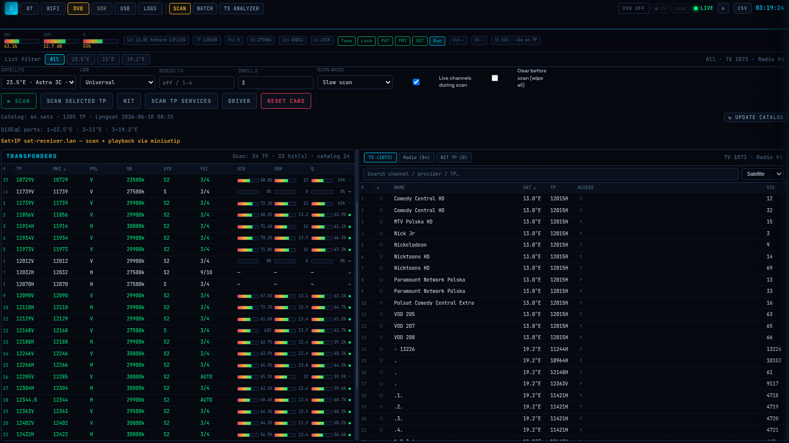
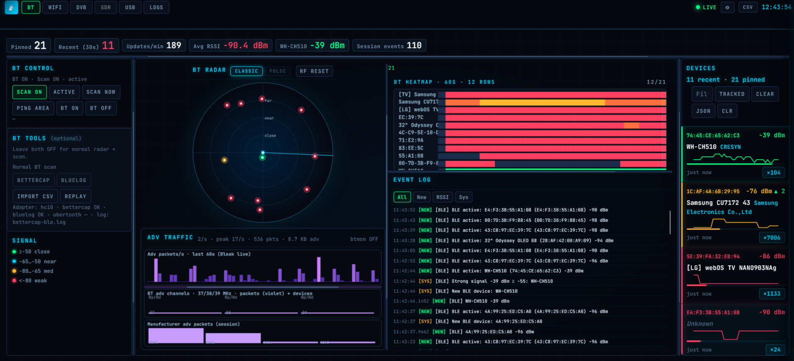
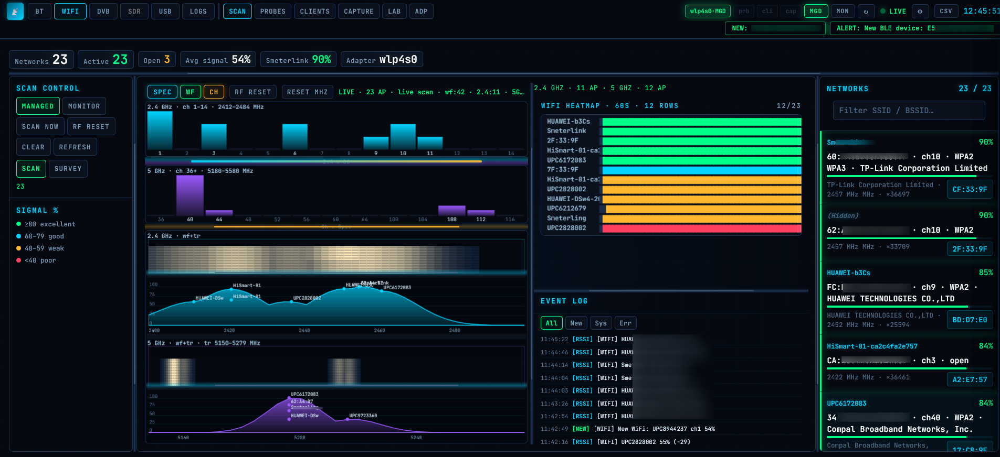
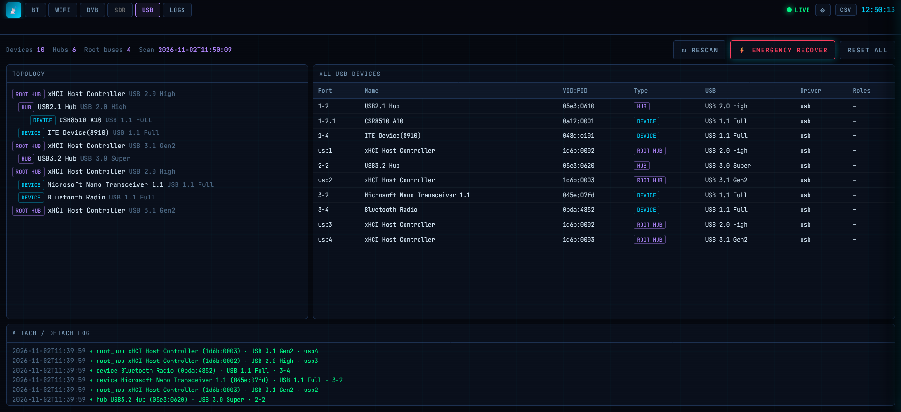

# LE HSCR — Radio Monitoring Workspace

Investigating the radio devices around a bench usually means one tool per radio: a Bluetooth scanner in one terminal, a Wi-Fi analyser in another, a tuner application for satellite and a shell for USB problems. LE HSCR puts them into one browser console. It shows what the connected Bluetooth LE adapter, Wi-Fi adapter and satellite tuner can see, keeps the history and merges the events of all radios into one stream.

It was built as one workspace for looking at which radio devices are around: Bluetooth, Wi-Fi, satellite reception and USB, for authorised radio and device investigations.

The operator opens one page. Bluetooth LE devices appear on a radar, Wi-Fi networks on a spectrum, satellite transponders and channels in a scan list that can be played, and the USB tree shows which adapter is still attached. The console runs in a Docker container with the adapters passed through, or directly on a prepared host, and stays on the local network.

## Tech stack

| Layer | Technologies |
|---|---|
| Backend | Python, FastAPI, Pydantic-validated WebSocket payloads |
| Interface | One HTML page with JavaScript, canvas charts and draggable panels, no build step |
| Data | DuckDB session store |
| Live updates | WebSocket plus REST |
| Radios | Bluetooth LE adapter (BlueZ), Wi-Fi adapter in managed or monitor mode (NetworkManager), DVB-S tuner or SAT>IP |
| Playback | HLS and MPEG-TS players in the browser |
| Packaging | Docker image based on Kali Linux, or a direct install on Ubuntu |

## Find nearby Bluetooth devices

The **BT** tab scans for Bluetooth LE devices and shows six figures at the top: Pinned, Recent (120s), Updates/min, Avg RSSI, Strongest and Session events. In **BT Control**, **Scan ON** starts or stops the scan, a toggle switches between active and passive scanning (passive sends no scan requests), **Scan now** triggers a discovery cycle and **Ping area** runs a 12 second active burst that asks nearby devices to answer. **RF reset** power-cycles the adapter without leaving the page.

The **BT Radar** places devices by signal strength in rings labelled close, near and far, in a Classic or a Pulse style. Colours follow four bands: stronger than -50 dBm is close, -65 to -50 near, -80 to -65 medium and weaker than -80 weak. Under it, **Adv traffic** charts advertisement packets per second over the last 60 seconds, packets and devices on channels 37, 38 and 39, and packets per manufacturer. A heatmap covers 60 seconds by default, and an event log filters by All, New, RSSI or Sys.

The **Devices** list filters by MAC or name, limits itself to **Tracked** devices, clears the session list and exports the live devices with their advertisement payload as JSON. iBeacon and Eddystone advertisements are parsed into readable fields, and **Watch beacon** adds a beacon to a watchlist that is stored on the server, so every browser sees the same list. Alert rules cover new devices, an RSSI threshold and watched beacon UUIDs. The value is a live answer to "what is advertising here, how close is it and has it been here before".

## Add recordings and replay to Bluetooth scans

The optional **BT Tools** group adds **Bettercap**, which listens passively and feeds its events into the live stream, and **Bluelog**, whose CSV files can be loaded with **Import CSV**. Both stay off for a normal radar and scan. **Replay** plays the stored observation history back at five times speed by default, for the last 60 minutes by default and up to 24 hours. Replay turns a short sighting into something that can be examined again after the device has gone.

## Scan the Wi-Fi spectrum

The **WiFi** tab starts on **Scan** and shows Networks, Active, Open, Avg signal, Strongest and the Adapter in use. **Managed** scans through the system network manager, **Monitor** switches the adapter to monitor mode, **Scan now** rescans, **RF reset** cycles the radio and **Scan** and **Survey** choose the spectrum source. Signal bands read 80 and above excellent, 60 to 79 good, 40 to 59 weak and below 40 poor.

The spectrum has three layers that can be switched on and off: **Spec** (trace line), **Wf** (waterfall history) and **Ch** (channel occupancy). 2.4 GHz covers 2400 to 2500 MHz in 2 MHz bins and 5 GHz covers 5150 to 5925 MHz in 4 MHz bins, each with its own row. **Reset MHz** restores the zoom and pan, which affect only the trace while the waterfall keeps the full band history. A 60 second heatmap, an event log (All, New, Sys, Err) and a **Networks** list filtered by SSID or BSSID complete the view, and the list exports to CSV.

## See who is probing for networks

The **Probes** sub-tab shows devices that ask for known networks. In monitor mode it reports Active (30s), Seen (5 min), Probes/min, SSIDs total, the sniffer state and the interface. **Top SSIDs (probed)** ranks the names being requested, with **Show all** for the full list, and **Active Probers** lists each device with a filter for MAC or SSID. The list exports to CSV. It answers which devices in range are looking for which networks.

## Pair clients with access points

The **Clients** sub-tab relates stations to the access points they talk to. **airodump ON** starts the feed and **airodump OFF** stops it; the tab shows Active (30s), Seen (5 min), Frames/min, APs, the sniffer state and the interface. The **Client ↔ AP** list filters by MAC, AP or SSID and exports to CSV. The value is a picture of which clients belong to which network without reading frame dumps.

## Manage Wi-Fi adapters

The **Adp** sub-tab lists the Wi-Fi adapters and shows the **Monitor Mode** card with the interface, the mode and whether the adapter is monitor capable. **Monitor**, **Managed** and **Refresh** switch and re-read the state. In **Settings**, one adapter is chosen for scanning and connecting in managed mode and another for monitoring (probes and clients), with USB and PCIe adapters both supported and auto-detection as the default, so two radios can share the work.

## Tune and scan satellite transponders

The **DVB** tab starts with the card off: the **DVB OFF** button powers it on. A live bar shows Sig, SNR, quality, Sat, TP, Pol, SR, Sys and Lk, and a pipeline of Tune, Lock, PAT, PMT, SDT and Svc steps. In the **Scan** sub-tab pick a **Satellite** (or the full catalogue), an **LNB** of Universal or Standard, a **DiSEqC 1.0** port from 1 to 4 and a **Dwell s** of 1 to 30 seconds, 3 by default. **Scan mode** offers Slow scan, Quick scan and Turbo quickscan, and a quick or turbo scan never wipes the stored channels. **Scan selected TP**, **NIT** and **Scan TP services** narrow the work to one transponder.

The transponder table lists TP, MHz, Pol, SR, Sys, FEC, Sig, SNR and lock, and the channel list splits into TV, Radio and NIT TP with search and sort by satellite, name, TP, SID, provider or access. **Update catalog** refreshes the satellite list from the OpenPLi satellites file. **Manual tune** in **Settings** takes a frequency in MHz, polarisation, symbol rate and DVBS or DVBS2, for testing one transponder.

<!-- TODO(screenshots, 2026-11-21): DVB scan view -->

## Watch and record satellite channels

The **Watch** sub-tab plays the selected channel from the TV, Radio or favourites list with **Play** and **Stop**. The player has a seek bar over the timeshift buffer, volume, mute, fullscreen, audio-track and DVB subtitle selectors, and a recording to a .ts file. The feed bar adds FEC, service bitrate, multiplex capacity, stream rate and BER. **Deinterlace** offers Off, BWDIF (SD), YADIF, YADIF 2x and W3FDIF for standard-definition channels. In **Settings** the stream is MPEG-TS or HLS, video is Transcode, Direct copy or an experimental Turbo mode, and the timeshift buffer is 15 to 180 seconds. A SAT>IP server can replace a local tuner, with its own port fields and a default DiSEqC port.

<!-- TODO(screenshots, 2026-11-21): DVB watch view -->

## Inspect a transport stream

The **TS Analyzer** sub-tab tunes a chosen **Satellite**, **Transponder** and **DiSEqC** port with **Tune & analyze**, and nothing starts by itself. The **SI Tree** lists the services on the transponder, and the PID table for the whole multiplex shows PID, type, packets, Mbps and load. It shows what a transponder actually carries before any channel is played.

## Check which USB adapters are attached

The **USB** tab counts Devices, Hubs and Root buses and shows when the last scan ran. **Rescan** refreshes the list, **Emergency recover** resets the host controller without a reboot (about 30 seconds) and **Reset ALL** clears the satellite, Bluetooth and Wi-Fi state of the app. The **Topology** tree and the **All USB devices** table (port, name, VID:PID, type, USB version, driver, roles) show how adapters hang off the hubs, and the attach and detach log records when one disappears. That is the first check when a radio goes quiet.

## Follow every radio in one log

The **Logs** tab starts with a live summary bar and a hardware summary bar, then lists **All Events** from all radios with filters All, New, RSSI, Sys and Err. A detail drawer shows one device. One timeline replaces a separate log per tool, which makes it easy to see that a Wi-Fi drop and a USB detach happened together.

<!-- TODO(screenshots, 2026-11-21): Logs view -->

## Tune the workspace

**Settings** (the gear in the top bar) covers notifications (beep on a new device, off by default; toast popups on; Bluetooth toasts on; Wi-Fi toasts off), heatmap length (60 seconds) and rows (12 each for Bluetooth and Wi-Fi), the stale time (3 to 180 seconds, 120 by default), font size per tab and log (100 percent), the spectrum layers, and a Wi-Fi scan interval of 1 to 30 seconds (2 by default). **Save** stores the choices and **Reset** restores the defaults. Layout and preferences are kept in the browser and synchronised through the server, so several browsers on the local network share them. **CSV** in the top bar exports the current list.

<!-- TODO(screenshots, 2026-11-21): Settings drawer -->

## Scope and limits

LE HSCR is meant for authorised radio research on equipment and networks the operator owns or is allowed to test. It receives and displays; satellite views need a compatible tuner and a signal, and the **SDR** tab is a placeholder for a later release. By default the console stays on the local network, sends no telemetry and keeps captures and logs on the local disk.

## Keep every radio in one view

The Bluetooth journey runs from the radar to the watchlist and the replay of a sighting. The Wi-Fi journey runs from the spectrum to the probing devices and their access points. The satellite journey runs from the transponder scan to a playing channel and its stream contents. USB and Logs connect these paths: when a view goes quiet, the adapter list and the combined event stream show why.

---

Private code: [le_hscr](https://github.com/logicencoder/le_hscr)

See [REPOS.md](REPOS.md) for related repositories.

**[Logic Encoder](https://logicencoder.com)** · [GitHub](https://github.com/logicencoder) · [Contact](https://logicencoder.com/contact/)
