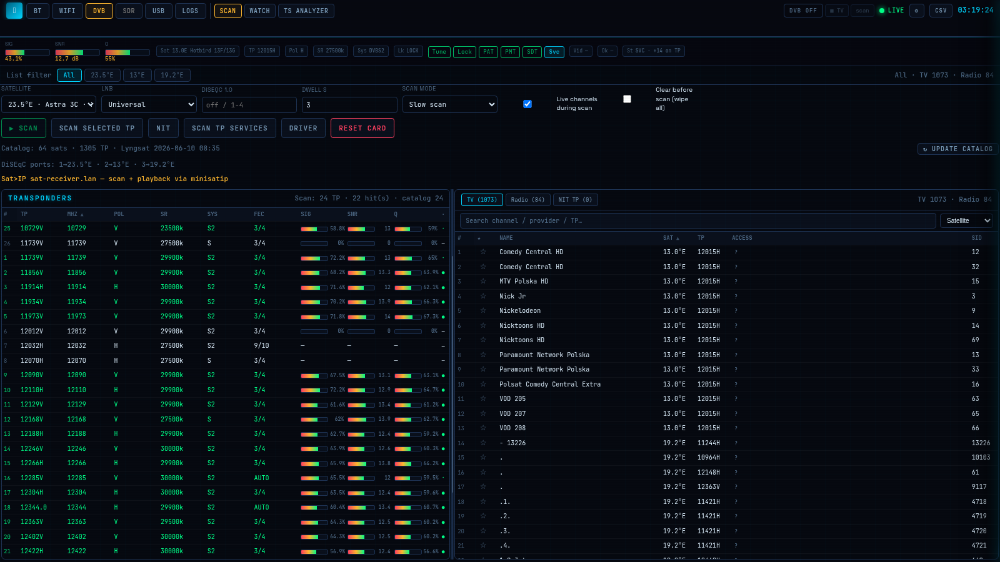

# LE HSCR — Radio Monitoring Workspace

Radio work can involve several devices, signal types and specialist utilities. LE HSCR brings Bluetooth, Wi-Fi and satellite inspection into one workspace, helping the operator understand what is visible, follow changes and keep useful observations together.

## Tech stack

| Layer | Technologies |
|---|---|
| Application | Python, FastAPI |
| Supporting technologies | HTML, CSS, JavaScript; Bluetooth LE, Wi-Fi, DVB |

## Bluetooth observations

Inspect nearby Bluetooth devices and follow their activity from a dedicated workspace. Device information, signal readings and observation history help distinguish a recurring device from a brief appearance. Filters make a busy environment easier to examine without losing the broader picture.

## Wi-Fi investigation

The Wi-Fi area brings network discovery and related observations together. Move between the available views to inspect access points, connected activity and signal context. The benefit is a consistent place to compare what the radio sees instead of reconstructing the picture from separate utilities.

## Satellite reception

Satellite views support examining reception and programme information alongside the other radio domains. Available playback and stream controls let the operator connect the observed signal with usable output. Reception depends on compatible equipment and the signals available to that equipment.

## Devices and shared logs

The USB area helps inspect attached equipment, while shared logs bring activity across radio areas into one view. This is useful when a problem may involve a device connection rather than the selected signal. Follow the relevant output before changing the monitoring setup.

## A workspace for laboratory use

Connection indicators, filters and global controls keep the current monitoring context visible. The dashboard is designed for a supported local radio setup; hardware availability determines which areas can be used.

---

Private code: [le_hscr](https://github.com/logicencoder/le_hscr)

See [REPOS.md](REPOS.md) for related repositories.

**[Logic Encoder](https://logicencoder.com)** · [GitHub](https://github.com/logicencoder) · [Contact](https://logicencoder.com/contact/)
