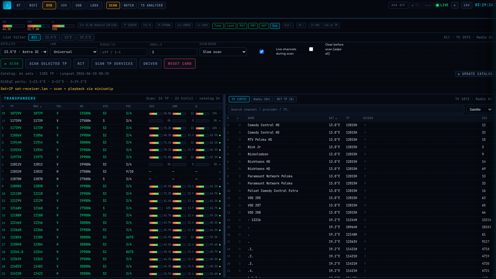

# LE HSCR — Radio Monitoring Workspace

LE HSCR is a single-page radio monitoring console for Bluetooth LE, Wi-Fi and satellite reception. One browser window shows what the connected adapters and tuner can see, keeps the history of what was seen and puts the logs of all radios in one stream. It runs in a Docker container with the USB adapters passed through, or directly on a prepared host, and by default it stays on the local network with no telemetry. It is meant for authorised radio research on equipment and networks the operator owns or is allowed to test.

## Tech stack

| Layer | Technologies |
|---|---|
| Backend | Python with FastAPI |
| Interface | One HTML page with JavaScript, draggable panels and charts |
| Radios | Bluetooth LE adapter, Wi-Fi adapter in managed or monitor mode, DVB satellite tuner or SAT>IP |
| Packaging | Docker image based on Kali Linux, or a direct install on Ubuntu |

## Overview

The Overview tab summarises all radios on one screen: Bluetooth, Wi-Fi and monitor key figures, the state of each adapter and the statistics of the current session. Adapter health is the first place to look when a view stays empty, and the reset actions for the Bluetooth and Wi-Fi adapters recover a stuck device without leaving the page.

## Bluetooth LE

The Bluetooth tab scans actively or passively and parses iBeacon and Eddystone advertisements into readable fields. A radar plots the nearby devices by signal strength, a channel strip shows activity on the advertising channels, and a heatmap shows where and when a device appears. Alerts follow a beacon UUID watchlist that is stored on the server so every browser sees the same list, and the observation history can be replayed. Scan logs from other tools can be imported, and the cross-radio analytics relate Bluetooth sightings to the other radios.

## Wi-Fi

The Wi-Fi tab scans for networks in managed or monitor mode and shows a spectrum trace with a waterfall. The trace can be panned and zoomed in megahertz while the waterfall keeps the full band history. Channel occupancy is shown in separate rows for 2.4 and 5 GHz, with a view of probe requests and of the clients seen. Adapter settings sit on the same tab.

## Satellite reception

The satellite area detects and identifies the tuner, powers it, and tunes by transponder or manually. It can scan transponders, read the network information table, analyse a transport stream and run a channel scan that builds a channel list, using a catalogue of satellites and transponders that can be refreshed. A live view of the transport stream shows the signal, and the TV player plays a selected programme with timeshift. This part needs a compatible tuner and a satellite signal.

## USB devices and logs

The USB area lists attached devices with their status and can refresh or reset a device, which is the first check when an adapter disappears. The Logs tab merges the events of all radios into one stream with filters, and the satellite and USB areas keep their own logs.

## Workspace

Panels are separated by draggable splitters across the key figures, controls, visualisation, lists and spectrum layers. Settings and layout are stored in the browser and synchronised through the server, so several browsers on the local network share the same preferences, and each tab keeps its own event log. Capture files and live logs stay on the local disk.

---

Private code: [le_hscr](https://github.com/logicencoder/le_hscr)

See [REPOS.md](REPOS.md) for related repositories.

**[Logic Encoder](https://logicencoder.com)** · [GitHub](https://github.com/logicencoder) · [Contact](https://logicencoder.com/contact/)
